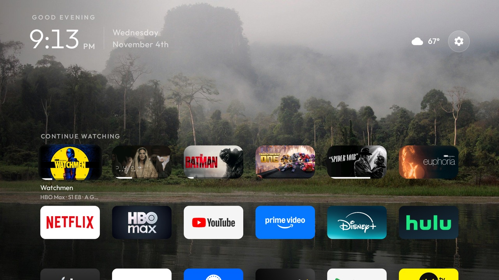

# Clean Your TV, enhanced

A fork of [cleanyourtv](https://github.com/Gathin23/cleanyourtv) whose launcher adds a few things the upstream
project keeps out of its core on purpose (its launcher has no network access by rule). Everything else, the
debloat lists, tools and safety checks, is upstream's and unchanged: read its README first and follow
`PROMPT.md` to clean a TV. Then install this launcher instead of upstream's.



## What is added

- **Continue watching shelf.** A row of poster cards just above the dock, read from the TV's own Watch Next
  table (`TvContract.WatchNextPrograms`): what your apps publish as continue-watching. Same size as the app
  tiles and aligned to the grid's columns; six show at a time and the row scrolls by whole cards one step
  early. Up from the dock lands on it, Up again on the top bar; it hides while the grid is scrolled. OK opens
  the title in its app through the app's deep link. Hulu, Disney+, Prime Video, Max, Peacock, Paramount+,
  Crunchyroll, Jellyfin and others publish rows; Netflix and YouTube do not, so they never appear.
  Needs `READ_TV_LISTINGS`, a runtime permission granted once over ADB (the install step below does it).
- **Real posters.** The cards show the apps' own artwork, fetched from the URLs the apps publish, cached in
  memory and on disk. This is why the fork holds the `INTERNET` permission.
- **Weather.** The outside temperature and a condition glyph left of the Settings gear, from
  [Open-Meteo](https://open-meteo.com/) (no account, no key), every 30 minutes while Home is on screen.
  Off until you put your coordinates in `config.xml` (`weather_latitude`, `weather_longitude`,
  `weather_pill`); Fahrenheit or Celsius.
- **One-press Restart** at the top of the gear button's quick settings panel: the key helper opens Android's
  power menu and clicks Restart for you. Needs `HOME_KEY_SERVICE=1` at install; the helper may read window
  content for that click (`canRetrieveWindowContent`). A sideloaded app cannot reboot a TV directly.
- **Header.** Tabular clock digits, so nothing shifts as the minutes change; the date on two lines
  ("Wednesday" / "November 4th").
- **Focus.** Names under the dock's tiles too; a near-white rim with a wider white glow (`glass_style: halo`).
- **Theme** `themes/nature-calm-enhanced/`: upstream's nature-calm photos with no dock band, no captions, no
  Inputs or Wi-Fi pills, and the halo focus.

## What uses the network

Only two files touch the network, checked by searching the source for network APIs:

| What | Where it connects |
|---|---|
| Continue watching posters | The image URLs the apps publish in the TV's Watch Next table (their own image servers); https only |
| Weather pill (off by default) | `api.open-meteo.com`, one small JSON reply every 30 minutes while Home is up |

Nothing is sent about you: the poster URLs and your coordinates are the only data in the requests. There is
no analytics, no background service and no polling while an app is in front.

## Install

The same toolchain as upstream (JDK 17, Android SDK 34, `tools/venv`), then from the repo root:

```sh
export TV_HOST=<tv ip>:5555
HOME_KEY_SERVICE=1 launcher/build-and-install.sh
tools/venv/bin/python -I tools/tv.py 'pm grant com.gathin.tvhome android.permission.READ_TV_LISTINGS'
tools/theme.sh themes/nature-calm-enhanced      # optional look
```

Switches in `launcher/app/src/main/res/values/config.xml`: `continue_watching` (the shelf), `weather_pill`
with the coordinates, `settings_key_scancodes` / `settings_key_keycodes` for your remote's gear button.

## Tested on

TCL Smart TV Pro (G05, G05_4K_US, MediaTek MT5889), Google TV 11, firmware AR2101 build AR70, 2.7 GB RAM,
on Wi-Fi. The launcher sits at about 105 MB with the shelf, posters and a true-colour wallpaper, and 0 CPU
while idle on Home.

## Licence

MIT, as upstream. The nature-calm photos are CC BY / CC BY-SA from Wikimedia Commons, see
`themes/nature-calm-enhanced/CREDITS.md`.
